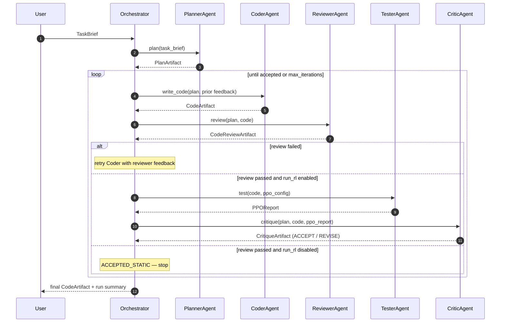

# Architecture

UML-style overview of the Qwen Agent v2 reward-generation pipeline.

## 1. Agents

Each agent is a class in [pipeline/](../pipeline/) with one public method. Below: concrete inputs and outputs (the fields each agent actually reads/produces), plus its job in one line.

### Planner ([pipeline/planner.py](../pipeline/planner.py))
- **In:** env source code, user prompt, task id
- **Out:** plan text, reward requirements, usable-tensor list
- **Task:** turn the user prompt and env code into a reward recipe the Coder can implement.

### Coder ([pipeline/coder.py](../pipeline/coder.py))
- **In:** env source code, plan text, user prompt, _(on retry: previous reward code, reviewer feedback, critic feedback)_
- **Out:** reward code (`_compute_generated_reward` body), raw LLM response, optional thinking trace
- **Task:** write the reward function body, optionally refining from prior feedback.

### Reviewer ([pipeline/reviewer.py](../pipeline/reviewer.py))
- **In:** reward code, plan text, usable-tensor list
- **Out:** pass/fail flag, feedback text, list of errors and warnings
- **Task:** run `static_check` (AST + mock exec) then an LLM compliance pass.

### Tester ([pipeline/tester.py](../pipeline/tester.py))
- **In:** reward code, PPO config (num_envs, max_iterations, timeout, headless, backend), run directory
- **Out:** status, exit code, log path, metrics summary
- **Task:** launch PPO training as an IsaacLab subprocess — or return a skipped report.

### Critic ([pipeline/critic.py](../pipeline/critic.py))
- **In:** plan text, reward code, PPO metrics summary
- **Out:** feedback text, `should_retry` flag (ACCEPT / REVISE)
- **Task:** judge whether the PPO metrics meet the plan's intent.

Under the hood these are bundled into frozen dataclasses (`TaskBrief`, `PlanArtifact`, `CodeArtifact`, `CodeReviewArtifact`, `PPOReport`, `CritiqueArtifact`) defined in [core/models.py](../core/models.py).

## 2. Configuration and Recording

Application config is loaded from [configs/app.yaml](../configs/app.yaml) via `load_app_config()` in [configs/app.py](../configs/app.py). The loader returns a plain dict, applies `QWEN_*` environment overrides, and exposes only small helpers such as `config_get("ppo.num_envs")`, `config_path("paths.runs_dir")`, and `build_ppo_config(...)`. `load_qwen_config()` and `load_qwen_server_settings()` remain as typed adapters over this central config.

Run artifacts are recorded by `RunRecorder` in [pipeline/logger.py](../pipeline/logger.py). `events.jsonl` is the primary run log; `conversation.md`, `full_conversation.md`, and `run_state.json` are rendered or mirrored from those recorded events. Python `logging` is reserved for technical process logs, and UI hooks in `RunHooks` are only for live status updates. Durable run analysis lives in the run directory:

- `task_brief.md`
- `env_code_context.md` audit copy of the environment context sent to the Planner
- `conversation.md`
- `full_conversation.md`
- `events.jsonl`
- `run_state.json`
- `final_reward.py` when a final candidate exists
- `ppo.log` / `ppo_summary.json` when PPO ran

## 3. Interaction order

`MultiAgentRewardSystem.run()` in [pipeline/orchestrator.py](../pipeline/orchestrator.py) runs the Planner once, then loops over Coder → Reviewer → (Tester → Critic). The loop exits on reviewer reject-and-out-of-budget, critic ACCEPT, or max iterations.

Terminal states: `ACCEPTED_RL`, `ACCEPTED_STATIC`, `FAILED_REVIEW`, `FAILED_RL`.

## 4. Tweakable parameters

### UI ([ui/](../ui/))

**Task form** ([ui/task_form.py](../ui/task_form.py)):

| Field | Type | Notes |
|---|---|---|
| `env_path` | Path | environment template to edit |
| `objective` | text | user prompt / reward goal |
| `run_rl` | bool | enable PPO validation loop |
| `max_iterations` | int 1–20 | Coder↔Reviewer budget |
| `max_rl_iterations` | int 1–8 | Tester↔Critic budget (only if `run_rl`) |
| `output_dir` | Path | run artifacts directory |
| `show_thinking.{planner,coder,reviewer,critic}` | bool | per-agent reasoning toggle |
| `ppo.num_envs` | int | parallel envs (central default 4096) |
| `ppo.max_iterations` | int | PPO training steps (central default 150) |
| `ppo.timeout_seconds` | int | wall-clock timeout (central default 300) |
| `ppo.headless` | bool | disable sim rendering |

**Sidebar / server control** ([ui/sidebar.py](../ui/sidebar.py), [ui/server_control.py](../ui/server_control.py)):

| Field | Default | Purpose |
|---|---|---|
| `host` | 127.0.0.1 | vLLM bind host |
| `port` | 8000 | vLLM bind port |
| `model_path` | — | local model weights |
| `served_model_name` | Qwen/Qwen3.5-4B | name exposed by vLLM |
| `max_model_len` | 11776 | context window |
| `gpu_memory_utilization` | 0.85 | vLLM GPU fraction |
| `max_num_seqs` | 1 | concurrent sequences |

### Server / LLM

**Local vLLM server** launched from [server/launcher.py](../server/launcher.py), configured via [server/settings.py](../server/settings.py) (`QwenServerSettings`, overridable via `QWEN_*` env vars):

| Key | Default |
|---|---|
| `model_path` | — |
| `served_model_name` | Qwen/Qwen3.5-4B |
| `host` / `port` | 127.0.0.1 / 8000 |
| `max_model_len` | 11776 |
| `gpu_memory_utilization` | 0.85 |
| `max_num_seqs` | 1 |
| `reasoning_parser` | qwen3 |
| `reasoning_config` | `{"reasoning_start_str":"<think>","reasoning_end_str":"</think>"}` |
| `startup_timeout_seconds` | 300 |

**LLM client** ([configs/app.yaml](../configs/app.yaml)):

| Key | Default |
|---|---|
| `base_url` | http://localhost:8000/v1 |
| `model` | Qwen/Qwen3.5-4B |
| `api_key` | EMPTY |
| `timeout_seconds` | 60 |
| `max_tokens` | 6500 |
| `enable_thinking` | false |
| `debug` | false |

Two sampling profiles (non-reasoning / reasoning) with own `temperature`, `top_p`, `top_k`, `presence_penalty`, `max_tokens`, `thinking_budget`.

### PPO

`PPOConfig` dataclass (in `core/models.py`) — consumed by [pipeline/tester.py](../pipeline/tester.py) and [ppo/runner.py](../ppo/runner.py):

| Field | Default | Purpose |
|---|---|---|
| `run_rl_training` | False | master switch |
| `num_envs` | 4096 | parallel envs |
| `max_iterations` | 150 | training steps |
| `timeout_seconds` | 300 | subprocess kill-switch |
| `headless` | True | disable sim window |
| `task_id` | qwen_agent_task | IsaacLab task id |
| `backend` | rl_games | `rl_games` / `skrl` / `rsl_rl` |
| `hooks` | `RunHooks()` | UI/live lifecycle hooks |

Framework-specific hyperparameters live in [agents/](../agents/):
- [rl_games_ppo_cfg.yaml](../agents/rl_games_ppo_cfg.yaml)
- [skrl_ppo_cfg.yaml](../agents/skrl_ppo_cfg.yaml)
- [rsl_rl_ppo_cfg.py](../agents/rsl_rl_ppo_cfg.py)

Shared defaults across frameworks: `lr 5e-4`, `gamma 0.99`, `lambda/tau 0.95`, `clip 0.2`, `entropy 0.0`, MLP `[64, 64]` with elu.

## 5. Prompts

All agent prompts live in [pipeline/prompts.py](../pipeline/prompts.py). Each agent has a static system prompt and a dynamic user prompt built per call.

### Planner — `PLANNER_SYSTEM_PROMPT`
Produce a compact, implementation-oriented reward plan. The Planner may write
brief free-form `Planning notes`, then emits a small Coder contract:
- `Primary objective`: one main objective from the user prompt, grounded in visible env signals.
- `Constraints`: only user-requested secondary terms.
- `Metrics`: 1-5 exact metric names, each prefixed with exactly one of `mean_` / `final_` / `max_`.
- `Usable tensors for Coder`: exact machine-read header used by the static checker.
- `Task scale hints`: visible timing, thresholds, reset ranges, or clamp bounds that help reward shaping.

### Coder — `CODER_INITIAL_PROMPT` (fresh) or `CODER_FEEDBACK_PROMPT` (retry), always combined with `CODER_RULES_PROMPT`
- **`CODER_INITIAL_PROMPT`**: implement the Planner artifact as a fresh reward body. Introduces the 7-form **reward toolbox** (exponential decay, rational falloff, linear clamp, linear/quadratic/vector-norm penalties, success bonus) and requires that primary-objective terms use bonus forms and enter the final sum with `+`.
- **`CODER_FEEDBACK_PROMPT`**: patch the existing code to address reviewer/critic feedback. Minimal edits; preserve Planner compliance first, then apply revision requests explicitly (missing component, progress signal, completion incentive, dominant term).
- **`CODER_RULES_PROMPT`**: hard output contract — one Python code block, body only, no prose/comments. Enforces three-section layout (raw signals → reward components → final `reward = sum`), tensor-op rules (no `keepdim=True`, no `torch.dot`, no `tensor[:, idx, :]`), and the metric-store conventions (`setdefault`+`+=` for `mean_`, direct assign for `final_`, `torch.maximum` for `max_`; always `[num_envs]`, always float).

### Reviewer — `REVIEWER_SYSTEM_PROMPT`
Scoped strictly to two jobs:
1. If static check **failed**, confirm the errors with actionable feedback.
2. If static check **passed**, verify only that Planner metric names and stores were transferred correctly (exact names, no combined prefixes, correct store, per-env float tensors, no mean reset inside the reward body).

Does **not** review reward quality or shaping choices. Output schema: `REVIEW: PASS|FAIL` + one-line `FEEDBACK:`.

### Critic — `CRITIC_SYSTEM_PROMPT`
Judges whether the PPO result meets the Planner's primary objective.
- **Acceptance gate**: the primary-objective acceptance metric only (`mean_success_rate`/`final_success` if present, else the first dense metric). Other primary-objective metrics are diagnostics to explain trends.
- **Revision policy**: if primary objective NOT met → only fixes that strengthen the primary-objective term (rescale, reshape, add missing success bonus, or weaken a constraint suppressing it). Never tighten constraints in this case. If primary objective IS met → at most one small constraint tweak per revision. Never weaken the primary objective for a constraint change.
- Reuses the 7-form toolbox; every form change must state `amplitude`, `sharpness`, `scale` explicitly. Output schema: `DECISION: ACCEPT|REVISE` + `DIAGNOSIS:` + `FIX:`.

### Prompt builders
`build_planner_prompt`, `build_coder_prompt`, `build_reviewer_prompt`, `build_critic_prompt` (bottom of [pipeline/prompts.py](../pipeline/prompts.py)) assemble the user prompts. Only the Planner prompt receives the full `TaskBrief`; Coder, Reviewer, and Critic consume the `PlanArtifact` plus the specific code/report/feedback they need.
